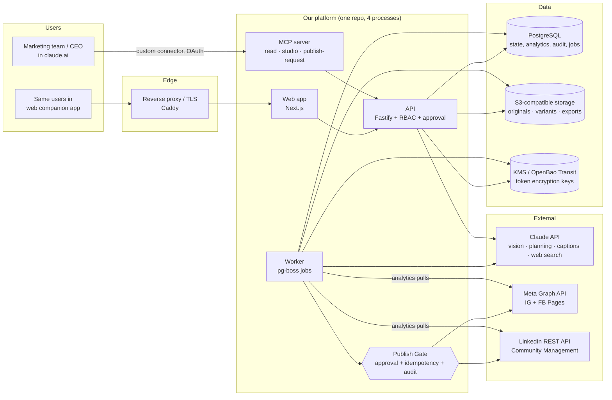
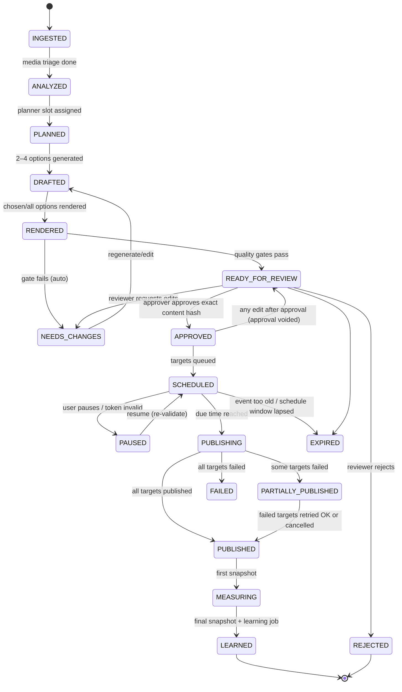

# Architecture (Sections C, M, O, R, S, T)

Status: **PROPOSED — awaiting acceptance** (2026-10-28). Platform facts referenced here are in PLATFORM_CAPABILITIES.md; decisions are numbered in DECISIONS.md.

## C.0 Shape of the system in one paragraph

A single TypeScript monorepo deploys **four processes** against **one PostgreSQL database** and **one S3-compatible bucket set**: a web app (Next.js), an API (Fastify), a worker (pg-boss jobs: ingestion, media, analytics, publishing, scheduling) and an MCP server (remote, OAuth-protected) that makes the whole system operable from Claude. Claude is called from the API/worker through the Claude API for every intelligence task (vision triage, feature extraction, planning, option generation, trend synthesis). Platform connectors are plain TypeScript adapters behind one interface. Every external write passes through one **Publish Gate** in the worker that checks the approval record, the account binding, the token, and an idempotency key, and writes an audit event in the same transaction. No Redis, no Kubernetes, no separate workflow cluster in MVP.

## C.1 MVP architecture diagram



## C.2 Component table

| # | Component | Responsibility | Recommended technology | Reason | License / OSS status | Alternative | Build vs buy |
|---|---|---|---|---|---|---|---|
| 1 | Web application | Upload inbox, event grouping review, calendar, post studio, variant comparison, approval screen, analytics, settings, audit view | **Next.js 16** (React) + Tailwind + shadcn/ui components, TanStack Query | Mature, one language with backend, server components for previews | Next.js MIT; Tailwind MIT; shadcn MIT (verified npm 2026-10-28) | React + Vite SPA served by API | Build (thin UI over API) |
| 2 | Backend / API | AuthN via company IdP, RBAC, domain commands, approval capture, signed upload URLs, read models | **Fastify 5** + **Zod 4** schemas, OpenAPI generated from Zod | Fast, schema-first, mature plugin ecosystem | MIT (verified) | Hono (MIT) | Build |
| 3 | Claude orchestration | All reasoning: media triage, event inference, feature extraction, planning, options, critique, trend synthesis | **Claude API** via `@anthropic-ai/sdk` (Apache-2.0). Default model `claude-opus-5-5`; structured outputs (`output_config.format`); prompt caching for brand/persona context; **Message Batches** (50% cost) for historical backfill; server tool `web_search_20260209` with `allowed_domains` for trend research | Claude-first principle; structured outputs make results machine-checkable | Proprietary service (not OSS) — the one intentional "buy" | None proposed (no second AI vendor) | Buy (API) |
| 4 | MCP | Lets users run the whole loop from Claude: list batches, see plan, compare options, edit, request approval, check queue/analytics | Remote MCP server, Streamable HTTP, **@modelcontextprotocol/sdk** (MIT, v1.32.2 verified), OAuth 2.1 protected resource; three tool groups with separate scopes (see MCP_TOOLING.md) | Clean least-privilege boundary; same tools usable by our backend agents and by claude.ai | MIT | Web-only UI (no MCP) | Build |
| 5 | Platform connector adapters | One interface per platform: discover accounts, list posts, fetch metrics, upload media, create post, get post status, refresh token | Plain TypeScript packages, `undici` fetch, per-platform rate-limit + error taxonomy, recorded-fixture tests | Official APIs only; no third-party schedulers | Our code | Postiz (AGPL-3.0) / Mixpost — rejected: we'd inherit their data model and still need our intelligence layer | Build |
| 6 | Relational DB | System of record for everything incl. jobs and audit | **PostgreSQL 17** (or 18) + **Drizzle ORM** migrations | Mature, JSONB where justified, row-level security option, one backup story | PostgreSQL License (OSI); Drizzle Apache-2.0 | Kysely (MIT) + plain SQL migrations | Buy managed (RDS/Cloud SQL/Neon) or self-host |
| 7 | Media / object storage | Originals (immutable), variants, renders, exports, previews | **S3 API**. Managed S3 / Cloudflare R2 by default; **SeaweedFS** if self-hosting is required | Pre-signed URLs needed for browser upload and for Meta fetch | SeaweedFS Apache-2.0 (verified). **MinIO rejected**: repo archived 2026-04-25, no community binaries | Garage (license `NEEDS VERIFICATION`), Ceph RGW (heavy ops) | Buy managed unless infra preference says self-host |
| 8 | Workflow / background jobs | Ingestion, media processing, Claude calls, analytics snapshots, scheduled publishes, token refresh, retries, DLQ | **pg-boss 12** on the same Postgres: retries with backoff, singleton keys, cron schedules, dead-letter queues, transactional enqueue with domain writes | No extra infrastructure; jobs commit atomically with state (outbox for free) | MIT (verified v12.38.0) | **Temporal** (MIT) when multi-day sagas outgrow jobs — Phase 3 review; Graphile Worker (MIT) | Build on library |
| 9 | Queue / cache | — | **None in MVP.** Postgres handles queue; HTTP caching only. Add **Valkey** (BSD-3) if a measured need appears | Fewer moving parts | Valkey BSD-3. Redis 8 is tri-licensed incl. AGPLv3 (no longer SSPL-only) | Redis 8 | Defer |
| 10 | Media processing workers | Decode, EXIF, perceptual hash, blur/exposure metrics, crops, colour, resize, encode, video transcode, thumbnails, subtitles burn-in | **sharp** (libvips) for images; **FFmpeg CLI** (invoked directly; `fluent-ffmpeg` is deprecated on npm) for video; **exifr** for metadata; dHash/pHash via sharp | Deterministic, fast, well-maintained | sharp Apache-2.0, libvips LGPL-2.1+, FFmpeg LGPL-2.1+ (GPL if built with x264 — fine for server use, flag for any distribution), exifr MIT | ImageMagick (own licence), imgproxy (MIT) for on-the-fly previews | Build on libraries |
| 11 | Template / carousel renderer | Deterministic typographic cards, quote cards, carousel slides, cover frames | **Satori** (JSX→SVG) + **resvg** (SVG→PNG); brand fonts loaded locally | Pure, reproducible, golden-testable; no headless browser | Both MPL-2.0 (file-level copyleft; fine to use unmodified) | Playwright HTML screenshot (Apache-2.0); **Remotion rejected for MVP**: source-available licence, company licence needed above 3 employees | Build |
| 12 | Analytics ingestion | Pull post/account metrics on a snapshot schedule, store raw JSON + normalized rows, compute baselines | Worker jobs + SQL views/materialized views | Data volume is small (thousands of posts) | — | dbt (Apache-2.0) later if analytics grows | Build |
| 13 | Trend intelligence | Collect, score, expire trend signals | Claude `web_search` with domain allow-list + RSS of official platform newsrooms + team "trend inbox" + own engagement data | Compliant sources only (Section I) | — | Paid social-listening vendor (deferred) | Build |
| 14 | Scheduler | Time-of-publish, analytics snapshot times, token refresh, weekly planning kick-off | pg-boss `sendAfter` / cron + `scheduled_job` table as source of truth | One mechanism for all platforms | MIT | Facebook native scheduling (not used, ADR-007) | Build |
| 15 | Approval system | Role-checked approvals bound to an exact content hash, step-up for CEO content | Our API + DB (`approval` table), WebAuthn step-up optional | Business rule must live in code, not prompts | — | — | Build |
| 16 | Audit logging | Append-only, hash-chained audit of every privileged action | `audit_event` table, insert-only role, hash chain, nightly export to object storage with Object Lock | Tamper evidence without new infra | — | pgaudit (PostgreSQL License) in addition | Build |
| 17 | Observability | Logs, metrics, traces, LLM usage, publish dashboard, alerts | **OpenTelemetry** SDK + Collector → **Prometheus** + **Grafana** + **Loki** + **Tempo**, or one managed OTel backend | Vendor-neutral instrumentation | OTel Apache-2.0; Prometheus Apache-2.0; Grafana/Loki/Tempo **AGPL-3.0** (fine for unmodified internal use; verified for Grafana) | Managed Grafana Cloud / Datadog (buy) | Self-host or buy (decide with infra) |
| 18 | Secret management | Platform OAuth tokens, app secrets, Claude API key | Envelope encryption: per-row data key, wrapped by cloud **KMS** or **OpenBao** Transit. App secrets from the platform's secret store | Tokens never stored in plaintext; never sent to Claude | OpenBao MPL-2.0 (verified). **HashiCorp Vault is BUSL-1.1 (source-available)** | Infisical (MIT core, `NEEDS VERIFICATION`) | Buy KMS if on cloud; else OpenBao |
| 19 | Identity for our users | SSO, roles | OIDC with company IdP (Google Workspace or Microsoft Entra) via `openid-client` (MIT); RBAC in our DB | No passwords to manage | MIT | Keycloak (Apache-2.0) if no IdP; Better Auth (MIT) | Buy IdP / build RBAC |
| 20 | Reverse proxy / TLS | HTTPS, OAuth redirect hosts, webhook endpoint | **Caddy** (Apache-2.0) | Automatic TLS, simple | Apache-2.0 (`NEEDS VERIFICATION` re-read) | Traefik (MIT) | Self-host |

## C.3 Technology comparison (the contested categories)

Licence facts verified on 2026-10-28 from the npm registry (npm packages) or the project's repository page. "OSS" = OSI-approved licence.

### Workflow orchestration / jobs

| Project | Purpose | License | OSS vs source-available | Self-host | Maturity evidence | Maintenance | Security notes | Ops burden | Verdict |
|---|---|---|---|---|---|---|---|---|---|
| **pg-boss** | Postgres job queue | MIT | OSS | Library | v12.x, long history | Active (12.38.0 on npm) | Uses our DB creds only | **Minimal** | **Selected (MVP)** |
| Graphile Worker | Postgres job queue | MIT | OSS | Library | v0.18 | Active | Same | Minimal | Alternative |
| Temporal | Durable workflows | MIT | OSS | Server cluster + DB | 23.7k stars (repo page) | Active (TS SDK 1.25.0) | Extra surface, mTLS setup | **High** (frontend/history/matching/worker services + DB) | Rejected for MVP; revisit Phase 3 |
| BullMQ | Redis queue | MIT | OSS | Needs Redis/Valkey | Widely used | Active (6.5.0) | Redis auth/TLS | Medium | Rejected (adds Redis) |
| Hatchet | Workflow engine | MIT (SDK verified) | OSS | Server + Postgres | Younger | Active | — | Medium | Not needed |
| Trigger.dev, Inngest, Windmill, n8n | Workflow platforms | Mixed; **n8n = Sustainable Use License (source-available)**; Inngest server SSPL-based; Windmill AGPL + EE | Some source-available | Yes | Popular | Active | Large surface | Medium–High | Rejected: platform lock-in, licence |

`NEEDS VERIFICATION`: Trigger.dev, Inngest, Windmill licences were not re-read today; they are rejected on fit regardless.

### Media / object storage

| Project | License | Status | Verdict |
|---|---|---|---|
| Managed S3 / Cloudflare R2 / GCS (S3 interop) | Proprietary service | Mature | **Default** |
| SeaweedFS | Apache-2.0 (verified) | Active, 34.1k stars; README admits catching up on some S3 policy/versioning features | **Self-host choice** (test Object Lock/versioning needs before relying on them) |
| Garage | `NEEDS VERIFICATION` (believed AGPL-3.0) | Active, lightweight | Alternative |
| MinIO CE | AGPL-3.0 | **Archived 2026-04-25; no community binaries; "no longer maintained"** (verified on repo) | **Rejected** |
| Ceph RGW | LGPL (`NEEDS VERIFICATION`) | Mature | Rejected for MVP (ops heavy) |

### Image / video processing

| Project | License | Notes | Verdict |
|---|---|---|---|
| sharp / libvips | Apache-2.0 / LGPL-2.1+ | 11.7k stars (libvips), fast, low memory | **Selected** |
| FFmpeg (CLI) | LGPL-2.1+ (GPL with x264/x265) | Industry standard. Use LGPL build if we ever distribute binaries | **Selected** |
| fluent-ffmpeg | MIT | **Deprecated on npm** (last modified 2025-05-22) | Rejected — call FFmpeg directly |
| ImageMagick | ImageMagick License (`NEEDS VERIFICATION`) | Larger attack surface (policy.xml hardening) | Not needed |
| imgproxy | MIT (OSS edition) | On-the-fly resize server | Optional later for UI previews |

### Typography / templates / carousels

| Project | License | Verdict |
|---|---|---|
| Satori + resvg-js | MPL-2.0 / MPL-2.0 | **Selected** — deterministic, golden-testable |
| Playwright (Chromium screenshot) | Apache-2.0 | Fallback for complex CSS layouts |
| Remotion | Custom source-available licence (free ≤3 employees; company licence above) | **Rejected for MVP**; reconsider for motion templates only with a paid licence |

### Optional generative / local image workflows (Phase 3+)

| Project | License | Verdict |
|---|---|---|
| ComfyUI | GPL-3.0 (`NEEDS VERIFICATION`) | Deferred; only for clearly-labelled illustrative assets, never documentary photos |
| Model weights (e.g. SDXL, FLUX variants) | Each has its own licence, several non-commercial | Must be checked per model before use; deferred |

### Observability

| Project | License | Verdict |
|---|---|---|
| OpenTelemetry SDK/Collector | Apache-2.0 | **Selected** for instrumentation |
| Prometheus | Apache-2.0 | Selected (metrics) |
| Grafana / Loki / Tempo | AGPL-3.0 (Grafana verified) | Selected if self-hosting; AGPL obligations only on modified, network-served copies |
| Sentry (self-hosted) | FSL (source-available) — `NEEDS VERIFICATION` | Not selected; Sentry SDK (MIT) can point at GlitchTip (`NEEDS VERIFICATION` licence) or managed Sentry |
| Langfuse | MIT core (npm verified) | Optional for LLM trace UI; MVP logs LLM calls to our own `llm_call` table |

### MCP tooling

| Project | License | Verdict |
|---|---|---|
| @modelcontextprotocol/sdk (TypeScript) | MIT | **Selected** (Tier-1 SDK) |
| Spec version | 2026-07-28 is final (stateless core, Tasks and MCP Apps extensions); claude.ai custom connectors documented support for earlier auth specs | Target 2026-07-28; keep backward compatibility until claude.ai support is confirmed (`NEEDS VERIFICATION`) |

### Scheduling

| Option | Verdict |
|---|---|
| pg-boss delayed jobs + `scheduled_job` table | **Selected** |
| node-cron / croner (ISC/MIT) | Not needed (pg-boss has cron) |
| Facebook native `scheduled_publish_time` | Not used in MVP (ADR-007) |

## M. Approval and publishing state machine

Two state machines: one per **post_candidate** (the content decision) and one per **publication target** (`scheduled_job` + `published_post`, one per identity×platform). Partial multi-platform failure is therefore visible per target.

### M.1 Candidate (content) states



`PARTIALLY_PUBLISHED` is added to the context's list because the context requires each target to have independent status.

### M.2 Target (publish job) states

`QUEUED → DUE → PRECHECK → UPLOADING → CONTAINER_READY (IG) / ASSET_READY (LI) → PUBLISH_SENT → CONFIRMED` with exits `RETRY_WAIT`, `FAILED_RETRYABLE`, `FAILED_PERMANENT`, `CANCELLED`, `UNKNOWN_OUTCOME` (timeout after send — reconcile before retry), `BLOCKED_AUTH` (token expired/revoked).

### M.3 Transitions, permissions, validations

| Transition | Who may trigger | Server-side validations |
|---|---|---|
| → READY_FOR_REVIEW | System only | Account, platform, goal, media, caption, grounding check, duplicate check, format/spec check, schedule recommendation and source traceability all present (context §29) |
| → APPROVED | User with `approve` on that identity (Admin; CEO for CEO identity; policy may require CEO for CEO content) via web UI or a signed approval link — **never by a model tool call** | Approver ≠ last editor if workspace policy "four-eyes" is on; approval binds `content_hash` = SHA-256 of (caption text, ordered media variant hashes, target account id, platform, scheduled time window); step-up auth (WebAuthn) for CEO identity if enabled |
| Edit after APPROVED | Editor | Approval row set `voided_by_edit`; state returns to READY_FOR_REVIEW |
| → SCHEDULED | Approver or `schedule` permission | Token valid for the time window (LinkedIn/Meta token expiry > scheduled time + 24 h, else warn); rate-limit budget available; no collision rule violated (soft warning) |
| Publish now | Same as approve + `publish_now` permission | Same checks; job enqueued with `run_at = now()` |
| Cancel | `schedule` permission | If target in `PUBLISH_SENT` or later → cannot cancel; offer "delete post" (separate audited action, platform permitting) |
| Pause all (kill switch) | Admin | Sets workspace `publishing_paused=true`; Publish Gate refuses all sends |

### M.4 Idempotency

- `idempotency_key = sha256(workspace_id ‖ post_candidate_id ‖ target_account_id ‖ platform ‖ content_hash)`; unique index on `scheduled_job(idempotency_key)` and on `published_post(idempotency_key)`.
- Publish Gate takes `SELECT … FOR UPDATE SKIP LOCKED` on the job row and only proceeds from `DUE`/`RETRY_WAIT`.
- **Before every send**, write `PUBLISH_SENT` intent with timestamp in the same transaction; after the platform responds, store the platform id. If the worker crashes between send and store → state `UNKNOWN_OUTCOME` → **reconciler** lists recent posts on the account (Meta: media list; LinkedIn: posts by author for org; for CEO member posts, cannot list → search by our stored container/asset id where possible, else human check) and matches by caption hash + time window before any retry. **No blind retries after send.**
- Instagram two-step: container creation is idempotent-safe (containers expire unused); only `media_publish` is the irreversible step and is guarded as above.
- LinkedIn returns 422 "Content is a duplicate" for identical content within ~10 minutes (seen on the UGC API error table) — treated as `UNKNOWN_OUTCOME` → reconcile, never as success or plain failure.

### M.5 Retries

| Error class | Examples | Action |
|---|---|---|
| Transient | 5xx, network, Meta 80001/80002 throttle, LinkedIn 429 | Exponential backoff with jitter (1, 2, 4, 8, 16 min), max 5, honour `estimated_time_to_regain_access` from `X-Business-Use-Case-Usage` |
| Media not ready | IG container `IN_PROGRESS`, LinkedIn video `PROCESSING` | Poll with backoff up to platform limit, then fail retryable |
| Auth | expired/revoked token, missing scope | `BLOCKED_AUTH`; notify account owner; job paused, not failed |
| Validation | wrong aspect ratio, caption too long | `FAILED_PERMANENT`; candidate → NEEDS_CHANGES (our pre-validators should catch these first) |
| Unknown after send | timeout after request left | `UNKNOWN_OUTCOME` → reconcile |

Dead-letter: after max retries the job goes to the DLQ and the dashboard shows it; nothing republishes without a human.

### M.6 Partial multi-platform failure

Each target has its own job; the candidate's aggregate state is derived. UI shows per-target chips (✓ LinkedIn company, ✗ Instagram company — "token expired", Retry / Cancel). Retrying a target never touches successful targets (idempotency key differs per target).

### M.7 Expired tokens

Daily job checks expiry; at T-14 d and T-3 d notifies; Meta long-lived tokens refreshed by job; LinkedIn refresh token (365 d, non-sliding) → re-consent reminder from T-30 d. A scheduled job whose token will be invalid at run time is flagged at scheduling time.

### M.8 Publish-now vs scheduled

Both go through the same job and Publish Gate; publish-now simply has `run_at=now()`. Scheduled jobs re-run all prechecks at `DUE` time (approval still valid, content hash unchanged, account still connected, workspace not paused).

## O. UX blueprint (MVP)

Principle: **Claude is the control plane; the web app is the companion** for things chat is bad at (bulk upload, visual side-by-side, drag-and-drop calendar) and for the approval click itself.

| Surface | MVP behaviour | In Claude (MCP) |
|---|---|---|
| Command center | "This week": batches, plan status, items awaiting your approval, scheduled queue, failures, connection health | `get_weekly_status` returns the same summary |
| Account onboarding | Wizard per identity: identity profile (voice, pillars, disallowed topics), connect platform (OAuth), shows granted scopes vs needed, capability matrix row with "Manual" lanes clearly marked, history import (API sync or upload export) | `list_accounts`, `get_account_capabilities` (read-only) |
| Weekly media inbox | Drag-and-drop folders → resumable direct-to-S3 upload; per-file status; duplicate/blurry badges; "do not use" toggle; consent flag | `list_batch_media`, `mark_media` (do-not-use, notes) |
| Event grouping | Cards per inferred event with hero + supporting images, proposed name/summary marked "inferred", merge/split/move, add facts (who/what/where) | `get_events`, `update_event_facts`, `merge_events` |
| Content calendar | Week grid per identity×platform, collisions highlighted, drag to move (re-runs time recommendation) | `get_plan`, `move_slot` |
| Post studio | One planned post: 2–4 options as columns; media order editable; caption editor with grounding highlights (every factual claim linked to a source fact); platform previews | `get_options`, `edit_option`, `regenerate_option(reason)` |
| Variant comparison | Side-by-side with objective, reasoning, confidence, risks; "why" panel with evidence counts | Same data; MCP Apps preview `NEEDS VERIFICATION` |
| Approval | Exact rendered preview per target, content hash, approve / request changes / reject; CEO step-up | `request_approval` returns a signed link — Claude cannot approve |
| Scheduled queue | Per target status, countdown, pause/cancel, retry failed | `get_queue`, `cancel_scheduled` (pre-send only) |
| Analytics | Per identity×platform: recent posts vs baseline (normalized), what's working (with confidence tiers), experiments | `get_performance`, `explain_post_performance` |
| Settings | Identities, roles, approval policy, posting targets, connections, kill switch | Read-only via MCP |
| Audit history | Filterable log; verify hash chain button | `get_audit_events` (Admin scope only) |

Least-repetition features: auto-plan on batch completion; "approve all for this event" (still per-target hash display); remember last edits as voice feedback; templates per recurring event type.

## R. Repository structure

```
smi/                                  # monorepo, pnpm workspaces
  apps/
    web/                              # Next.js companion app
    api/                              # Fastify HTTP API (+ OAuth callbacks, webhooks)
    worker/                           # pg-boss job runners (all job types, one process, concurrency per queue)
    mcp/                              # remote MCP server (separate deployable, separate scopes)
  packages/
    domain/                           # entities, state machines, policies (pure TS, no IO) <- business rules live here
    db/                               # Drizzle schema, migrations, repositories
    connectors/
      core/                           # Connector interface, error taxonomy, rate-limit budget
      meta-instagram/
      meta-facebook/
      linkedin/
      manual/                         # manual-handoff "connector" (CEO FB profile etc.)
    intelligence/                     # Claude calls: prompts as versioned files, schemas, evaluators
      prompts/                        # *.md prompt templates + JSON schemas, versioned
      evals/                          # golden sets + graders
    media/                            # sharp/ffmpeg pipelines, recipes, quality metrics
    rendering/                        # Satori templates, fonts, brand kits
    analytics/                        # normalization, baselines, scoring, scheduler model
    publishing/                       # Publish Gate, reconciler, idempotency
    auth/                             # OIDC, RBAC, approval step-up
    audit/                            # hash-chained audit writer + verifier
    config/                           # env schema (Zod), feature flags
    observability/                    # OTel setup, log redaction
    testing/                          # fixtures, fake platform servers, factories
  infra/
    docker/                           # Dockerfiles, compose for local + single-VM prod
    terraform/                        # (when cloud chosen)
  docs/                               # the files in this folder; docs/adr/ for ADR detail
  tests/
    e2e/                              # Playwright: upload → approve → publish against fake platforms
    contract/                         # connector contract tests vs recorded fixtures
```

Changes from the starting idea: `workers/media` and `workers/analytics` merged into one `apps/worker` (queues, not processes, separate concerns until scale says otherwise); `packages/domain` holds state machines and policies so prompts never own business rules; `packages/publishing` isolated because it is the highest-risk code; `packages/intelligence/evals` exists from day one.

## S. Testing strategy

| Layer | What | Tooling |
|---|---|---|
| Unit | Domain state machines (every allowed/forbidden transition), scoring formulas, normalization, idempotency key derivation | Vitest 5 (MIT) |
| Connector contract | Each adapter against **recorded real responses** (sanitized) + documented error payloads; schema drift test fails CI when a fixture no longer parses | Vitest + Zod schemas; fixtures refreshed from sandbox monthly |
| Mocked platform APIs | Fake Meta/LinkedIn HTTP servers implementing the subset we use incl. throttling, 422 duplicate, container IN_PROGRESS, token expiry | MSW 3 (MIT) or a small Fastify fake in `packages/testing` |
| Sandbox / test accounts | Meta: test Page + test IG professional account owned by our business; LinkedIn: test page + test member profile (LinkedIn permits test profiles that don't interact with real members) | Manual + nightly smoke against sandbox (publish → verify → delete) |
| Media golden tests | Each edit recipe on a fixed corpus → compare output against golden files with perceptual diff tolerance; spec checks (IG JPEG, aspect ratios, reel 9:16, LinkedIn ≤36,152,320 px) | Vitest + sharp + pixel diff |
| Scheduling | Fake clock; DST transitions in Asia/Kolkata (no DST) and audience zones that have DST; collision rules | Vitest |
| Idempotency | Kill worker between send and store; duplicate job delivery; concurrent workers; assert exactly one platform call per key | Testcontainers (Postgres) + fake platform counting calls |
| Permissions | Matrix test: every role × every API route/MCP tool × identity | Generated tests |
| Prompt evaluations | Golden sets per task (triage, event grouping, feature extraction, options, CEO-voice) with graders (schema validity, rubric scored by Claude as judge with human-labelled calibration set) | promptfoo (MIT) or own runner in `packages/intelligence/evals` |
| Grounding / hallucination | Every factual span in a caption must map to a `fact` (event fact, product fact, metric). Checker extracts claims and verifies; any ungrounded claim blocks READY_FOR_REVIEW | Claude extraction + deterministic matcher; red-team set with planted false facts |
| E2E | Upload batch → plan → options → approve → publish (fake platform) → snapshot → learning record | Playwright 1.64 (Apache-2.0) |

## T. Observability and cost controls

| Area | Definition |
|---|---|
| Structured logs | JSON (pino), fields: `ts, level, service, trace_id, span_id, workspace_id, identity_id, job_id, candidate_id, target_id, platform, event`. Redactor strips tokens, `Authorization`, signed URLs, emails |
| Metrics | `publish_attempts_total{platform,outcome}`, `publish_latency_seconds`, `unknown_outcome_total`, `jobs_queued/active/failed{queue}`, `job_age_seconds`, `token_days_to_expiry{account}`, `platform_rate_budget_remaining{platform,account}`, `llm_tokens_total{task,model,type}`, `llm_cost_usd_total{task}`, `media_processing_seconds{recipe}`, `upload_to_plan_seconds`, `option_acceptance_ratio`, `regeneration_total` |
| Traces | OTel spans across API → job → Claude call → connector call; W3C trace context propagated into MCP `_meta` |
| Publishing dashboard | Next 7 days queue, last 7 days outcomes per target, DLQ, UNKNOWN_OUTCOME count (must be 0), connection health grid |
| Queue monitoring | pg-boss queue sizes, oldest job age, retry counts, DLQ size |
| Model/token usage | `llm_call` table: task, prompt version, model, input/output/cache tokens, cost, latency, result validity, candidate id; weekly cost per identity |
| Processing cost | CPU-seconds per recipe, storage bytes per batch, egress for platform fetches |
| Trend research cost | Count of `web_search` uses and tokens per trend run; cap per week |
| Alerts | Any `UNKNOWN_OUTCOME`; publish failure on due job; token expiring < 7 d; DLQ > 0; job age > 15 min on publish queue; LLM spend > 80% of monthly budget; platform 4xx spike; audit chain verification failure |
| Workspace usage limits | Per workspace monthly caps: Claude spend (hard stop for non-publishing tasks, publishing never blocked by AI budget), max media per batch (e.g. 2,000), max video minutes processed, trend searches per week |
