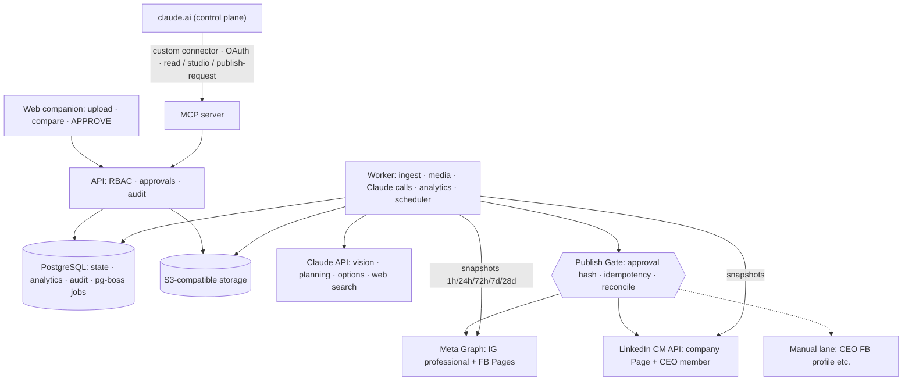

# Phase 0 Architecture Blueprint — Social Media Intelligence & Publishing Automation

Date: 2026-10-28 · Status: **PROPOSED — awaiting acceptance** · Platform facts verified against official docs on 2026-10-28.

## Where each section lives

| Section | Document |
|---|---|
| A. Assumptions and open questions | OPEN_QUESTIONS.md |
| B. Platform capability matrix | PLATFORM_CAPABILITIES.md |
| C. Product architecture + technology comparison | ARCHITECTURE.md |
| D. Claude + MCP boundary | MCP_TOOLING.md |
| E. Data model | DATA_MODEL.md |
| F. Historical learning · G. Weekly upload intelligence · I. Trends · J. Planner · K. Options · L. Scheduling | CONTENT_INTELLIGENCE.md |
| H. Creative / media pipeline | MEDIA_PIPELINE.md |
| M. Approval & publishing state machine · O. UX · R. Repo · S. Testing · T. Observability | ARCHITECTURE.md |
| N. Security threat model | SECURITY_THREAT_MODEL.md |
| P. MVP vs later · Q. Roadmap · top risks · first 15 tasks | ROADMAP.md |
| Decisions / limitations / context | DECISIONS.md, KNOWN_LIMITATIONS.md, PROJECT_CONTEXT.md |

## The five findings that shape everything

1. **CEO accounts are the weak link.** A personal Facebook profile cannot be published to by API (since 2018); a personal Instagram account has no API at all; the CEO's LinkedIn history cannot be listed by API (`r_member_social` is closed). CEO LinkedIn *publishing* and *analytics for new posts* do work.
2. **LinkedIn vetting is the critical path.** Community Management API needs a dedicated app (it must be the only product on it), company verification, then a Standard-tier screencast of a working app. Development tier allows only 500 calls/app/day.
3. **Neither Instagram nor LinkedIn offers native scheduling**, so our own scheduler and Publish Gate own time-of-publish for every platform.
4. **Meta keeps removing metrics** (Instagram impressions/plays in April 2025; Facebook Page reach/impressions on June 15 2026, "not 1:1" replacements), so raw snapshots and a versioned metric catalogue are mandatory.
5. **MinIO is no longer a safe default** (repository archived April 2026); Postgres + pg-boss + S3-compatible storage keeps the MVP to two stateful services.

## Closing item 1 — Recommended MVP architecture (one diagram)

Items 2–4 (top 10 risks, first 15 tasks, information needed) are in ROADMAP.md and OPEN_QUESTIONS.md.
