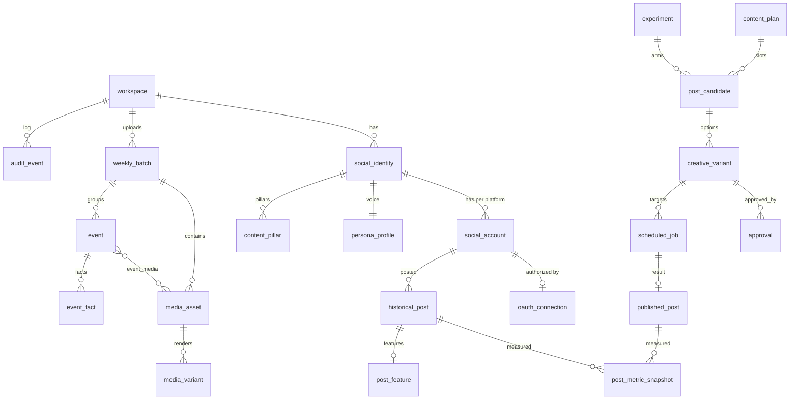

# Data Model (Section E)

Status: PROPOSED (2026-10-28). PostgreSQL 17+. All primary keys are internal `uuid` (UUIDv7, time-ordered). Platform identifiers are attributes with unique constraints, never PKs. Every table has `created_at timestamptz default now()`; mutable tables have `updated_at` and `version int` (optimistic concurrency). `workspace_id` on every tenant table (single tenant now, cheap insurance; enables Postgres row-level security later).

JSONB is used only for: (a) **raw platform payloads** (must be preserved verbatim, schema not ours), (b) **Claude structured outputs** that are versioned by prompt version, (c) **edit recipes** (a declarative, versioned program). Everything we query or join on is a real column.

## E.1 Entity overview

## E.2 Tables

### Tenancy and people

| Table | Key fields | Notes / indexes |
|---|---|---|
| `workspace` | id, name, default_timezone, publishing_paused bool, policy jsonb* | *policy = approval policy document (versioned, validated by Zod) |
| `app_user` | id, workspace_id, idp_subject unique, email, display_name, status | |
| `role_assignment` | id, user_id, role enum(`admin`,`content`,`ceo`,`viewer`), identity_id nullable (null = all identities) | unique(user_id, role, identity_id) |

### Identities and accounts

| Table | Key fields | Notes / indexes |
|---|---|---|
| `social_identity` | id, workspace_id, kind enum(`company`,`ceo`), display_name, timezone, audience_geographies text[], languages text[], min_approval_level enum, auto_publish_policy enum(`off`) | Company and CEO are separate rows; nothing is shared implicitly |
| `persona_profile` | identity_id PK/FK, tone_formality 1–5, humor 0–3, emoji_policy, caption_length_pref, hashtag_strategy, cta_style, disallowed_topics text[], legal_notes, voice_examples_ref, learned_voice jsonb (versioned output of voice analysis), version | Learned voice stored separately from human-entered rules |
| `content_pillar` | id, identity_id, name, description, target_share numeric, active | |
| `social_account` | id, identity_id, platform enum(`instagram`,`facebook`,`linkedin`), platform_account_id, account_type enum(`ig_business`,`ig_creator`,`fb_page`,`li_organization`,`li_member`,`manual`), handle, lane enum(`api`,`manual`), capability_snapshot jsonb (scopes granted, features available, checked_at) | unique(platform, platform_account_id); unique(identity_id, platform) for MVP |
| `oauth_connection` | id, social_account_id, provider_app enum, granted_scopes text[], access_token_ciphertext bytea, refresh_token_ciphertext bytea, dek_wrapped bytea, kek_id, access_expires_at, refresh_expires_at, status enum(`active`,`expiring`,`revoked`,`error`), connected_by_user_id, last_verified_at | Tokens only ciphertext; decrypt only in worker/API process memory. Index on access_expires_at |

### Historical data and analytics (raw vs normalized)

| Table | Key fields | Notes / indexes |
|---|---|---|
| `historical_post` | id, social_account_id, platform_post_id, source enum(`api`,`import_csv`,`published_by_us`), published_at, format enum(`image`,`carousel`,`video`,`reel`,`story`,`text`,`document`,`link`), caption text, media_count, permalink, raw jsonb, imported_batch_id | unique(social_account_id, platform_post_id); index(social_account_id, published_at desc) |
| `historical_post_media` | id, historical_post_id, position, media_type, platform_media_url (may expire), stored_asset_id nullable | We mirror thumbnails only for feature extraction (retention below) |
| `metric_definition` | id, platform, metric_key (e.g. `ig.media.views`), scope enum(`post`,`account`), unit, semantics text, valid_from date, valid_to date nullable, replaced_by_id nullable, comparable_to_previous bool | **Versioned metric catalogue**: e.g. `fb.post.post_impressions_unique` valid_to 2026-06-15, replaced_by `fb.post.post_total_media_view_unique` with comparable_to_previous=false |
| `post_metric_snapshot` | id, subject_type enum(`historical_post`,`published_post`), subject_id, captured_at, age_hours int, source enum(`api`,`csv`,`manual`), api_version text, raw jsonb (exact response) | Raw layer. index(subject_type, subject_id, captured_at) |
| `post_metric_value` | snapshot_id, metric_definition_id, value numeric, PK(snapshot_id, metric_definition_id) | Normalized layer (long format). Missing metric = no row (never 0) |
| `account_metric_daily` | social_account_id, metric_definition_id, day date, value, raw_snapshot_id | Followers, reach, etc. PK(account, metric, day) |
| `post_feature` | historical_post_id PK, feature_schema_version, extracted_by_prompt_version, pillar_id, topics text[], event_type, hook_type, cta_type, caption_chars, hashtag_count, mention_count, emoji_count, has_question bool, person_count_bucket, visual_style enum, has_text_overlay bool, designed_vs_photo enum, is_ceo_first_person bool, posted_local_dow, posted_local_hour, event_to_post_delay_h, features jsonb (long tail), confidence jsonb | Columns for everything used in scoring; jsonb only for exploratory features |
| `post_score` | subject_id, goal enum, model_version, baseline_id, normalized_value, z_robust, percentile_in_baseline, confidence_tier, computed_at | One row per post per goal per model version |
| `baseline` | id, social_account_id, format, metric_definition_id, window_end, n_posts, median_log, mad_log, half_life_days | Rolling baselines for reproducibility |

### Weekly media and events

| Table | Key fields | Notes / indexes |
|---|---|---|
| `weekly_batch` | id, workspace_id, week_start date, created_by, status enum(`uploading`,`processing`,`ready`,`planned`,`closed`), instructions text, requested_post_counts jsonb* | *{identity_id: {platform: n}} validated |
| `media_asset` | id, batch_id, storage_key (originals bucket), sha256 unique-per-workspace, mime, bytes, width, height, duration_ms, captured_at (EXIF), gps geography nullable, camera, phash bigint, dhash bigint, sharpness, exposure_score, noise_score, face_count, quality_tier enum(`hero`,`good`,`weak`,`reject`), duplicate_of_id, near_dup_cluster_id, do_not_use bool, consent_status enum(`unknown`,`ok`,`restricted`), claude_description jsonb (prompt_version), uploaded_by | index(batch_id), index(phash) using btree + bit-distance query in app; unique(workspace_id, sha256) |
| `media_variant` | id, media_asset_id (or composite source), recipe_hash, recipe jsonb, purpose enum(`preview`,`ig_feed`,`ig_reel`,`fb_feed`,`li_image`,`li_multi`,`thumb`), storage_key, width, height, bytes, sha256 | unique(recipe_hash) → pure-function cache |
| `event` | id, batch_id, name, name_source enum(`inferred`,`user`), summary, summary_source, event_date, location_text, status, version | Inferred values are labelled |
| `event_media` | event_id, media_asset_id, role enum(`hero`,`support`,`excluded`), rank | PK(event_id, media_asset_id) |
| `event_fact` | id, event_id, key, value, source enum(`user`,`document`,`exif`), source_ref, entered_by | **Only facts in this table (or the approved fact library) may appear as claims in captions** |
| `approved_fact` | id, workspace_id, identity_scope, statement, source_ref, valid_until | Product/company facts library |

### Planning, options, approval, publishing

| Table | Key fields | Notes / indexes |
|---|---|---|
| `trend_signal` | id, platform, title, description, evidence jsonb (urls, retrieved_at), discovered_at, expires_at, freshness, momentum, ip_risk, reputational_risk, fit_company, fit_ceo, status | index(expires_at) |
| `content_plan` | id, workspace_id, week_start, batch_id, status, planner_model_version, rationale, version | unique(workspace_id, week_start, version) |
| `post_candidate` | id, plan_id, identity_id, platform, event_id nullable, pillar_id, goal enum, slot_window tstzrange, state enum (M.1), priority, experiment_arm_id nullable, score_breakdown jsonb, version | index(plan_id), index(state) |
| `creative_variant` | id, post_candidate_id, option_no 1–4, objective, concept, media_order uuid[], recipe jsonb, caption, hook, cta, hashtags text[], mentions jsonb, alt_text text[], recommended_window tstzrange, reasoning, confidence numeric, risk_notes, grounding_report jsonb, prompt_version, content_hash, status enum(`draft`,`selected`,`discarded`), edited_by_user bool | unique(post_candidate_id, option_no) |
| `caption_edit` | id, creative_variant_id, before, after, editor_id, created_at | Learning signal |
| `approval` | id, creative_variant_id, content_hash, targets jsonb (identity/platform list), approver_id, decision enum(`approved`,`changes_requested`,`rejected`), comment, step_up_method, decided_at, voided_at, voided_reason | index(creative_variant_id); approval valid iff not voided and hash matches |
| `scheduled_job` | id, creative_variant_id, social_account_id, approval_id, run_at, state enum (M.2), idempotency_key unique, attempt, last_error_code, last_error_detail, platform_container_id, sent_at, pg_boss_job_id | index(state, run_at) |
| `published_post` | id, scheduled_job_id unique, social_account_id, platform_post_id, permalink, published_at, idempotency_key unique, raw jsonb | unique(social_account_id, platform_post_id) |
| `experiment` | id, workspace_id, identity_id, hypothesis, variable, control_desc, objective_metric_id, min_sample, status, result jsonb, decision, decided_at | |
| `experiment_arm` | id, experiment_id, label, spec jsonb | |
| `recommendation_feedback` | id, subject_type, subject_id, action enum(`selected`,`rejected`,`edited`,`regenerated`,`rescheduled`,`published_now`), reason, user_id | User-choice learning |
| `llm_call` | id, task, prompt_version, model, input_tokens, output_tokens, cache_read_tokens, cost_usd, latency_ms, ok bool, error, subject_ref, trace_id | Cost + quality accounting |

### Audit

| Table | Key fields | Notes |
|---|---|---|
| `audit_event` | id (bigserial for chain order), occurred_at, workspace_id, actor_type enum(`user`,`system`,`mcp`), actor_id, action, subject_type, subject_id, before jsonb, after jsonb, ip, user_agent, trace_id, prev_hash bytea, hash bytea | Insert-only DB role (no UPDATE/DELETE grant); `hash = sha256(prev_hash ‖ canonical_json(row))`; nightly anchor of latest hash written to object storage with Object Lock |
| `access_log` | id, user_id, tool_or_route, subject_ids, at | Reads (cheap, 90-day retention) |

## E.3 Retention

| Data | Retention | Reason |
|---|---|---|
| Original uploads (`media_asset` objects) | Until batch closed + 180 days, unless used in a published post (then keep 3 years) or flagged do-not-use (delete after 30 days) | Unpublished-media leak minimization |
| Rendered variants | 90 days unless published (keep 3 years) | Regenerable from recipe |
| Raw metric snapshots | 3 years | Platforms only return 2 years (Meta) or 12 months (LinkedIn org time-bound); our copy is the only long history |
| Normalized metrics, features, scores | Indefinite (small) | Learning |
| OAuth tokens | Deleted immediately on disconnect | |
| Audit events | 7 years (`ASSUMPTION` — confirm legal requirement) | |
| access_log, llm_call detail | 90 days / 1 year | |
| Historical post media thumbnails | 1 year after feature extraction | Feature extraction only; respects platform storage terms (`NEEDS VERIFICATION` of Meta/LinkedIn data storage terms) |

LinkedIn publishes data storage requirements that apply to Standard-tier apps (L2); read them before finalizing retention (`NEEDS VERIFICATION`).
