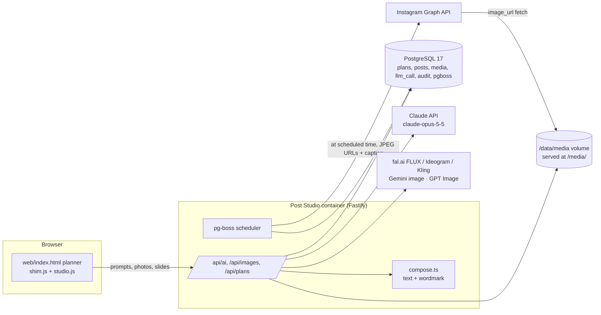

# Implementation notes (as of 2026-10-31)

This is what exists in the repo now, how a week flows through it, and what is stubbed.

## How the pieces fit



Who develops it: you and Claude, in this Claude project (repo attached, PRs from threads) or in Claude Code on a laptop. Both read `CLAUDE.md` and `docs/`. The running app uses its own `ANTHROPIC_API_KEY`; the Pro plan pays for development only.

## A week, end to end

1. Open the studio (team password). `/api/status` tells the page which keys are set.
2. Step 1: agree the number of posts (Claude can suggest). Step 2: event facts, consent box, up to 15 raw photos; "Pick the best photos" sends downsized photos to `/api/ai/json`, Claude scores them. Step 3: deterministic edits in the browser (levels, light, colour, warmth, sharpen, 4:5 crop).
3. Step 4: Claude plans the remaining posts and writes three options per post (caption, hashtags, alt text, slides).
4. Per post: **Generate visual with AI** asks Claude for an image brief (brand visual direction, space left for the headline) and calls the default image provider (`/api/images/generate`); click a result to place it on the current slide. **Rewrite** asks Claude to change one option in your words.
5. **Post / Schedule**: the browser renders the slides as 1080×1350 JPEGs and uploads them (`/api/images/upload?kind=render`); the post is saved and approved on the server (approval hash = caption + image ids; `[CONFIRM]` gaps are refused). If Instagram is connected and `IG_PUBLISH_ENABLED=true`, a pg-boss job is queued for the scheduled time and `publish/instagram.ts` publishes it. Otherwise the page says so and offers the zip download for manual posting.

## What is real and what is stubbed

| Area | State |
|---|---|
| Plans, posts, approval, state machine, audit log, LLM usage log | Real (tested in `tests/api.test.ts`) |
| Claude text / JSON / vision calls | Real, needs `ANTHROPIC_API_KEY` |
| Image generation and photo editing | Real adapters for fal.ai (FLUX, Ideogram, Kling), Gemini, OpenAI. **Not yet exercised against live APIs**: model ids and request fields in `src/images/*.ts` were written from the SDKs' docs and must be checked with real keys |
| Compositor (text + wordmark over an image) | Real (`/api/images/compose`), unit-tested; the UI still renders slides in the browser and uploads them. Switching slide rendering to the server compositor is the next UI step |
| Instagram publishing + scheduler | Real code path, **never run against Instagram**. Needs the Meta app, IG login token, `PUBLIC_BASE_URL` over HTTPS, and `IG_PUBLISH_ENABLED=true`; test on a test professional account first |
| Trend research (web search) | Not built. Users paste trends. Next: Claude web search tool server-side + Instagram Business Discovery for public accounts |
| Reference accounts / taste model | Not built. Next: a `reference_post` table + a prompt that studies them |
| Insights loop (post results → next plan) | Not built (`docs/ROADMAP.md` Phase 4) |
| LinkedIn, Bonton Holidays, Market Maya accounts | Not built |
| MCP server exposing the studio to Claude | Not built (ADR-009 scopes still apply when it is) |
| CI/CD deploy to the server | CI builds and tests; deploy job added once the server is reachable |

## Running it

```bash
cp .env.example .env            # fill APP_PASSWORD, SESSION_SECRET, POSTGRES_PASSWORD, PUBLIC_BASE_URL, keys you have
docker compose up -d --build    # app on :8080, Postgres on an internal network, media on a volume
# with HTTPS on a subdomain (ports 80/443 open, DNS pointing at the server):
DOMAIN=social.multiicon.in docker compose -f docker-compose.yml -f docker-compose.caddy.yml up -d --build
```

Health: `GET /healthz`. Status of keys: `GET /api/status`. Logs: `docker compose logs -f app`.

## Environment variables

See `.env.example`. Every key is optional except the three passwords and `PUBLIC_BASE_URL`; a missing key turns that feature off and the UI says so.
