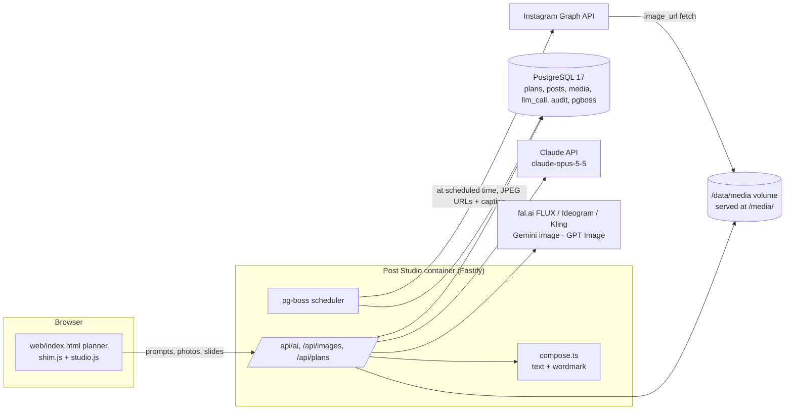

# Implementation notes (as of 2026-10-31)

This is what exists in the repo now, how a week flows through it, and what is stubbed.

## How the pieces fit



Who develops it: you and Claude, in this Claude project (repo attached, PRs from threads) or in Claude Code on a laptop. Both read `CLAUDE.md` and `docs/`. The running app uses its own `ANTHROPIC_API_KEY`; the Pro plan pays for development only.

## A week, end to end

1. Open the studio (team password). `/api/status` tells the page which keys are set.
2. Step 1: agree the number of posts (Claude can suggest). Step 2: event facts, consent box, up to 15 raw photos; "Pick the best photos" sends downsized photos to `/api/ai/json`, Claude scores them. Step 3: deterministic edits in the browser (levels, light, colour, warmth, sharpen, 4:5 crop).
3. Step 4: Claude plans the remaining posts and writes three options per post (caption, hashtags, alt text, slides).
4. Per post: **Generate visual with AI** asks Claude for an image brief (brand visual direction, space left for the headline) and calls the default image provider (`/api/images/generate`); click a result to place it on the current slide. **Rewrite** asks Claude to change one option in your words.
5. **Post / Schedule**: the browser renders the slides as 1080×1350 JPEGs and uploads them (`/api/images/upload?kind=render`); the post is saved and approved on the server (approval hash = caption + image ids; `[CONFIRM]` gaps are refused). If Instagram is connected and `IG_PUBLISH_ENABLED=true`, a pg-boss job is queued for the scheduled time and `publish/instagram.ts` publishes it. Otherwise the page says so and offers the zip download for manual posting.

## What is real and what is stubbed

| Area | State |
|---|---|
| Plans, posts, approval, state machine, audit log, LLM usage log | Real (tested in `tests/api.test.ts`) |
| Claude text / JSON / vision calls | Real, needs `ANTHROPIC_API_KEY` |
| Image generation and photo editing | **With only `ANTHROPIC_API_KEY`**, the "Claude design" provider (`src/images/claude-design.ts`) is used: Claude writes the artwork as SVG (gradients, shapes, icons, simple illustration, no text), the server strips anything unsafe and renders it to PNG, and compose.ts adds the headline and wordmark. It cannot make photos or real-looking people; it is listed last, so any real image model with a key takes over as the default. Real adapters for Gemini (default), fal.ai (FLUX, Ideogram, Kling) and OpenAI. With no `DEFAULT_IMAGE_PROVIDER`, the first provider with a key is used. Gemini was checked against the live API on 16 Nov 2026: the key authenticates and lists the image models, but image models have **no free tier** (quota 0), so billing must be on for the key's Google project. Default model `gemini-3.1-flash-image` (Nano Banana 2, about $0.10 per 2K image); `gemini-3-pro-image` for text-heavy slides. Live check on the server: `docker compose exec app node dist/tools/check-images.js`. Higgsfield API adapter (`src/images/higgsfield.ts`, Soul 2 by default) is written from docs.higgsfield.ai but **not yet tested with a live key**; it needs a separate prepaid API balance, since higgsfield.ai website plan credits and Unlimited models do not apply to the API. Until then, images made on the Higgsfield website are uploaded into Post Studio. fal.ai and OpenAI adapters are still untested against live keys |
| Compositor (text + wordmark over an image) | Real (`/api/images/compose`), unit-tested; the UI still renders slides in the browser and uploads them. Switching slide rendering to the server compositor is the next UI step |
| Instagram publishing + scheduler | Real code path, **never run against Instagram**. Needs the Meta app, IG login token, `PUBLIC_BASE_URL` over HTTPS, and `IG_PUBLISH_ENABLED=true`; test on a test professional account first |
| Trend research (web search) | Not built. Users paste trends. Next: Claude web search tool server-side + Instagram Business Discovery for public accounts |
| Reference accounts / taste model | Not built. Next: a `reference_post` table + a prompt that studies them |
| Insights loop (post results → next plan) | Not built (`docs/ROADMAP.md` Phase 4) |
| Bonton Holidays and Market Maya Instagram sections | Built 16 Nov 2026: own weeks, voice, pillars, app theme and slide design per brand. Publishing still needs each account connected |
| LinkedIn | Not built |
| MCP server exposing the studio to Claude | Not built (ADR-009 scopes still apply when it is) |
| CI/CD deploy to the server | CI builds and tests; deploy job added once the server is reachable |

## Running it

```bash
cp .env.example .env            # fill APP_PASSWORD, SESSION_SECRET, POSTGRES_PASSWORD, PUBLIC_BASE_URL, keys you have
docker compose up -d --build    # app on :8080, Postgres on an internal network, media on a volume
# with HTTPS on a subdomain (ports 80/443 open, DNS pointing at the server):
DOMAIN=social.multiicon.in docker compose -f docker-compose.yml -f docker-compose.caddy.yml up -d --build
```

Health: `GET /healthz`. Status of keys: `GET /api/status`. Logs: `docker compose logs -f app`.

## Environment variables

See `.env.example`. Every key is optional except the three passwords and `PUBLIC_BASE_URL`; a missing key turns that feature off and the UI says so.

## Slide design by Claude (16 Nov 2026)

When a post is written, the planner sends its selected option to `POST /api/design/post`. Claude first plans a look for the post (palette, type pairing, motifs, and a different technique and layout for every slide), then designs each slide as one SVG with its words, in parallel (at most four Claude calls at a time). The server:

- removes anything unsafe from the SVG and swaps `photo:1` placeholders for the team's own photo;
- rejects any word that is not in the slide's own text, and any slide that drops headline or body words (rule 2), and sends the problem back to Claude (up to three attempts);
- renders the words alone to find their edges and rejects text that runs off the canvas or into the bottom band;
- adds the MULTIICON wordmark and page number itself, then saves a 1080x1350 JPEG.

The planner shows that image as the slide. Editing a slide's words or photo drops its design (so what is approved is what is seen). "New Generate themes" redesigns the post as a variation of the current look or a completely new one. Fonts for designs: Inter, Inter Display and IBM Plex (Serif, Sans Condensed, Mono), installed in the Docker image. Rough cost on Claude Opus 5.5: about $0.15 to $0.25 per slide, so $3 to $5 for a four-post week.

## Brand sections (16 Nov 2026)

The rail has a company switcher: Multiicon, Market Maya, Bonton Holidays. Picking one reloads the page with `?brand=`; the choice is remembered.

- `src/ai/brand.ts` is the registry. The server serves it to the page as `/brands.js` (loaded first, so the right colours paint immediately) and adds the brand's facts and voice to every Claude call (`brand` on `/api/ai/*`).
- Plans: `PUT /api/plans` takes `brand`; it is stored as `plan.account` (the Instagram handle), already part of the unique key, so no migration was needed and Multiicon's weeks are untouched. `GET /api/plans?brand=` and `GET /api/plans/:week?brand=` filter by it.
- Writing: planning, photo picking and the three options use the brand's audience, cadence and content pillars. Market Maya's risk line is added to every caption in code, and `POST /api/posts/:id/approve` refuses a Market Maya caption without it.
- Design: `/api/design/post` takes `brand`; the designer gets the brand's palette, type pairing and style, the CTA line uses its handle, the word check allows its handle and wordmark, and the server draws its wordmark in the footer.
- App theme: `web/app.css` tokens are channel variables (`--acc-rgb` etc.) repainted per `:root[data-brand]`, dark and light.
- Logos are text wordmarks for now; real logo files were not reachable from the build environment.
